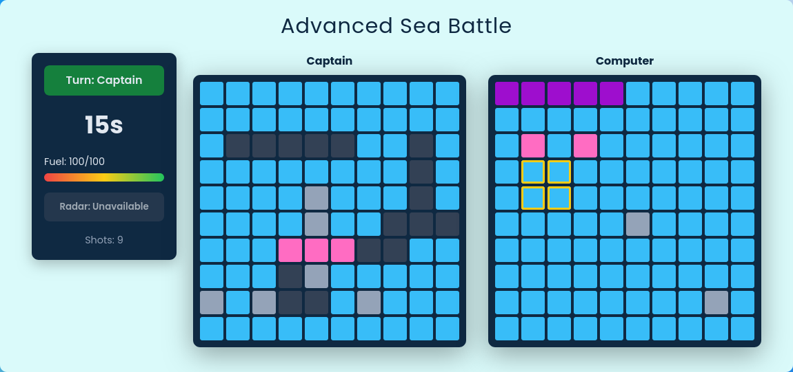
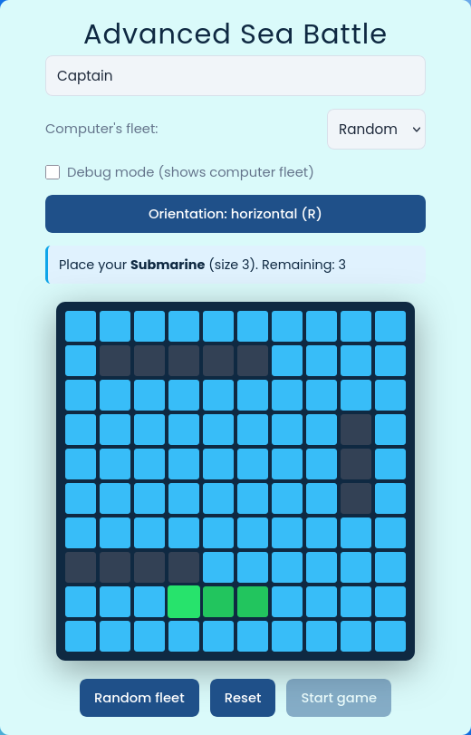
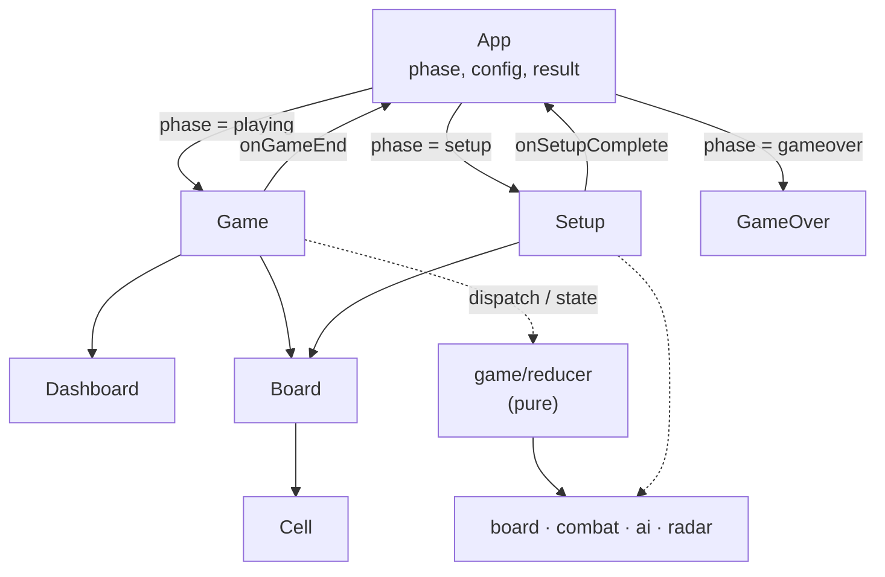

# Advanced Sea Battle

[](https://github.com/jasiu12345678/advanced-sea-battle/actions/workflows/ci.yml)


A Battleship variant with resource management: every shot burns **fuel**, every turn is on a **15-second clock**, and fast hits are rewarded with a **radar**. The opponent is a **hunt/target AI**.

**[▶ Play it live](https://jasiu12345678.github.io/advanced-sea-battle/)**

<p align="center">
  
</p>

<p align="center">
  
</p>

## Features

- Manual fleet placement with a live valid/invalid preview, `R` to rotate, bounds and overlap validation — or a one-click random fleet
- Computer fleet: 3 predefined layouts or random
- Debug mode that reveals the computer's fleet
- Live dashboard: turn indicator, countdown timer, fuel bar, radar state, shot counter
- Advanced computer AI (see below)
- End screen with winner, reason, shot count and restart
- Keyboard-friendly, screen-reader labels on every cell (`A1: water`), responsive board size
- Game rules implemented as a pure, unit-tested reducer — the UI only renders state and dispatches actions

## Game rules

| Mechanic | Rule |
|---|---|
| Board / fleet | 10 × 10, ships of size 5, 4, 3, 3, 2, 2 |
| Fuel | Starts at 100. Each shot costs 5, a hit refunds 10 (max 100). Fuel at 0 = immediate loss |
| Turn timer | 15 s. When it runs out the turn passes to the computer and costs 5 fuel |
| Radar | Unlocked by hitting a ship in under 3 s. Free action (no turn, no fuel); highlights a 2 × 2 area containing an undamaged ship part. One use per unlock |
| Win | Sink the whole enemy fleet, or the enemy runs out of fuel |

## Computer AI

Two modes, kept in a small `aiMemory` object (`{ mode, targetQueue }`):

- **Hunt** – shoot random cells on a checkerboard pattern (the smallest ship covers 2 cells, so half of the board can be skipped).
- **Target** – after a hit, queue the orthogonal neighbours. Once two hits line up, both ends of that line jump to the front of the queue. When a ship sinks, the queue is rebuilt from any *other* damaged-but-afloat ship, so adjacent ships are not forgotten.

Over 3 000 simulated games on random fleets the AI needs **≈ 56 shots** on average to clear the board (a random shooter needs ~95). See [`src/game/ai.js`](src/game/ai.js).

## Tech stack

React 19 (function components, `useReducer`) · Vite · Vitest · ESLint (react-hooks) · plain CSS (BEM-style) · GitHub Actions

## Architecture



- `App` only owns the phase and passes data between phases.
- `Game` is a thin shell around `useReducer(gameReducer)`: it runs the turn countdown and the delayed computer move as effects and dispatches `PLAYER_SHOT`, `COMPUTER_SHOT`, `TICK`, `USE_RADAR`.
- Everything non-deterministic (random AI shot, radar area, timestamps) is computed *outside* and passed in as action payload, so the reducer is pure and fully testable without rendering.
- Constants (fuel values, timings, board size, fleet) live in `src/constants/`.

## Getting started

```bash
git clone https://github.com/jasiu12345678/advanced-sea-battle.git
cd advanced-sea-battle
npm install
npm run dev        # http://localhost:5173
```

| Script | What it does |
|---|---|
| `npm run dev` | Dev server with HMR |
| `npm run build` | Production build to `dist/` |
| `npm run preview` | Serve the production build |
| `npm test` | Run unit tests (Vitest) |
| `npm run lint` | ESLint |

## Project structure

```
src/
├── components/
│   ├── setup/       # name, fleet placement (with preview), enemy fleet, debug toggle
│   ├── game/        # useReducer shell: countdown + computer-move effects
│   ├── dashboard/   # turn, timer, fuel bar, radar button, shot counter
│   ├── board/       # 10×10 grid
│   ├── cell/        # single cell (water / miss / hit / sunk / ship / preview)
│   └── game-over/   # result screen
├── game/            # pure game logic + tests
│   ├── board.js     # geometry, placement validation
│   ├── fleet.js     # random + preset fleets
│   ├── combat.js    # shot resolution, win check
│   ├── ai.js        # hunt/target AI
│   ├── radar.js     # 2×2 radar area
│   └── reducer.js   # game state machine (fuel, timer, radar, turns)
└── constants/       # board size, fuel, timings, fleet definition
```

## Roadmap

- [ ] Probability-density AI (track which ships are still afloat)
- [ ] Difficulty levels (random / hunt-target / density)
- [ ] Touch-friendly placement (tap to rotate)
- [ ] Sound effects and hit animations
- [ ] Persist stats (win rate, best shot count) in `localStorage`
- [ ] Component tests with React Testing Library

## License

[MIT](LICENSE) © Mateusz Rembas
